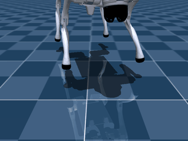
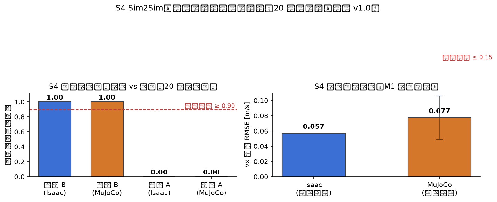

# 分层具身智能：从四足运动控制到机械臂 VLA 的受控验证

**基于分层强化学习的四足机器人运动控制系统设计与仿真验证**（毕业设计项目仓库）

[](https://github.com/Anhao1314/go2w-locomotion/actions/workflows/ci.yml)
[](LICENSE)
[](pyproject.toml)

**受控对比研究：分层强化学习架构 vs 端到端单层**——同一任务、同一观测、同一冻结种子，唯一变量是有没有显式分层。在此基础上延伸出三条已验证的工程线：**跨引擎迁移（S4 Sim2Sim）**、**ROS2 真 DDS 闭环**、**VLA 模仿学习**（进行中）。

[English](README.en.md) · [文档索引](docs/README.md) · [实验协议](docs/EXPERIMENT_DESIGN.md) · [研究报告](docs/PHASE1_REPORT.md) · [过程日志](docs/journal/)

---

## 一句话结果

> 在同一长程任务、同一观测、同一训练预算下，**四阶段长程任务上分层架构在全部 3 个训练种子以 100 迭代收敛到 100% 成功率；端到端单层仅 1/3 种子成功（450 迭代），其余 2 个种子 1500 迭代完全失败**。分层把训练成功率从 1/3 提到 3/3，收敛时间从"最好 450 迭代 / 最差永不"压缩到稳定的 100 迭代。失败可归因：单层不收敛的种子全部死在"行走→原地转向"的步态切换处。

**方法论注脚**：只跑 seed 2 会得出"单层也行只是慢 4.5 倍"，只跑 seed 0/1 会得出"单层完全不可行"——都错。多种子不是锦上添花，是结论正确性的前提。

## 三条验证线 · 核心数字

| 验证线 | 判据（冻结协议） | 结果 | 状态 |
| --- | --- | --- | --- |
| **L3 分层 A/B 对比**（Isaac Lab 2.7，3 训练种子 × 20 冻结种子） | 分层成功率 vs 单层 | 分层 **3/3 种子 100%**（100 迭代收敛）；单层 1/3（450 迭代） | ✅ |
| **S4 Sim2Sim**（RQ4：零策略改动 Isaac → MuJoCo） | 序列成功率 ≥ 0.90 | **20/20（1.00）**；vx_rmse 0.077 ≤ 0.15 ✅；完成步数 474 vs Isaac 406.7 | ✅ |
| **ROS2 真 DDS 闭环**（Go2 桥，ROS-R1 级） | 独立探针验证指令→状态回传 | **`ROS2_R1_PASS`**：582 消息/话题（含 TF），前进 1.24 m，转向 +1.59 rad | ✅ |
| **VLA 模仿学习**（SmolVLA × 官方教师数据） | 仿真评测成功率（20+ episodes） | 🚧 SmolVLA 微调运行中（官方真机教师数据 50 episodes） | 🔄 |

所有数字由冻结协议（[EXPERIMENT_DESIGN.md](docs/EXPERIMENT_DESIGN.md) v1.0，2026-10-22 预注册）判定：评估种子 `E={0..19}`、指标单一实现（[locomotion/eval/metrics.py](locomotion/eval/metrics.py)）、反樱桃采摘规则、负结果留档。

## 演示

| 场景 | 视频/图 |
| --- | --- |
| 分层：四阶段长程任务成功（Isaac 训练侧） | [分层完成 L3](media/training/robot_motion_l3_layered.mp4) |
| 端到端：同任务在转向处摔倒（Isaac 训练侧） | [单层失败](media/training/robot_motion_l3_single_fail.mp4) |
| **S4：分层策略零改动在 MuJoCo 完成四阶段** | [MuJoCo 分层序列](media/training/s4_layered_sequence.mp4) |
| **S4：单层策略在 MuJoCo 同种子即摔** | [MuJoCo 单层失败](media/training/s4_single_fail.mp4) |
| 样本效率曲线（3 种子） | [A/B 对比曲线](media/training/sweep_ab_comparison.png) |
| 收敛统计 | [全种子收敛图](media/training/convergence_all_seeds.png) |

**S4 Sim2Sim 直观对比**（同种子、同任务：分层完成 vs 单层即摔）：



## 系统组成

```text
任务/阶段管理（规则层：闭环速度指令 + 阶段判定）
   │  [vx, wz] 指令
   ▼
S1 指令策略（PPO，2 维动作）──分层组──┐
                                      ├→ 12 维关节 → Unitree Go2（Isaac Sim 5.1）
S0 locomotion 策略（PPO，冻结复用）──┘
   ▲
48 维本体观测（M1 预训练：vx_rmse 0.057 m/s，三种子）
```

- **单层组**：53 维观测直接输出 12 维关节——与分层组完全相同的观测与任务信息
- **分层组**：S1 在 2 维指令空间学习，执行委托给预训练并冻结的 S0

## S4 Sim2Sim：零策略改动跨引擎迁移（RQ4）

把 Isaac 训练的策略**原封不动**（ONNX 导出，权重逐位一致 + SHA-256 锚定）搬进 MuJoCo：

| 指标 | Isaac（训练引擎） | MuJoCo（迁移后） | 冻结阈值 |
| --- | --- | --- | --- |
| vx_rmse | 0.0569 ± 0.0011 | **0.0773 ± 0.0285** | ≤ 0.15 ✅ |
| 序列成功率（分层组） | 1.00（20/20） | **1.00（20/20）** | ≥ 0.90 ✅ |
| 序列成功率（单层组） | 0.00 | **0.00（全摔）** | 失败模式一致 |

**结论**：分层 vs 端到端的成败差异**跨物理引擎成立**；量化差距（vx +35%、转向 -62%）与单因素归因（被动关节参数、扭转摩擦敏感性）已记录于 [S4 文档](locomotion/sim2sim/README.md)。实现细节：[导出链](scripts/export_s4_policy.py) · [评测器](scripts/eval_s4_sim2sim.py)。



## ROS2 在线桥：真 DDS 闭环（ROS-R1 级）

[`ros2/go2_bridge/`](ros2/go2_bridge/README.md)：双向闭环——`/go2/cmd_vel` 进（限幅 + 0.5 s deadman 安全门），`/clock + /joint_states + /base_pose + /tf + session_info` 出（50 Hz，全部标准消息类型）。**真 DDS 验收 `ROS2_R1_PASS`**（两个独立进程，582 消息/话题含 TF，前进 1.24 m，转向 +1.59 rad），CI 硬门禁 [ros2-live-r1](.github/workflows/ros2-live-r1.yml)。7 次验收尝试含 6 次负证据全部留档（[acceptance.md](ros2/go2_bridge/acceptance.md)）。

## VLA 模仿学习（进行中）

教师数据路线：自建脚本专家（[vla/](vla/README.md)，WIP 保留——操作臂示范生成的可靠性问题已如实记录）→ **官方真机遥操作数据集** `lerobot/svla_so101_pickplace`（50 episodes，人类教师示范）。SmolVLA（450M）微调运行于 [`so101-tabletop-mujoco`](https://huggingface.co/lerobot/so101-tabletop-mujoco) 同构任务，完成后在仿真评测成功率（≥20 episodes + 专家对照视频）。

## 工程设施（可复现性）

| 设施 | 说明 |
| --- | --- |
| 预注册协议 | 冻结评估种子 E={0..19}、指标与阈值先于训练冻结（[EXPERIMENT_DESIGN](docs/EXPERIMENT_DESIGN.md)） |
| 每 run 证据束 | `run_config.json`（git SHA/依赖版本/命令行）+ 全文件 SHA-256 清单，训练结束自动生成 |
| 收敛即停 | 训练中每 50 迭代做一次 2048 环境确定性评估，连续达标自动早停并记录收敛点 |
| CI | 341+ 测试（Python/C++/pybind/ROS2 契约）+ **ROS2 真 DDS 门禁**（[ros2-live-r1](.github/workflows/ros2-live-r1.yml)） |
| 过程日志 | [docs/journal/](docs/journal/)：按日记录目标、决策、失败与修正 |

## 诚实边界

- **仿真限定**：无真机实验；S4 跨引擎结论适用于 Isaac Sim 5.1 与 MuJoCo 3.11 两引擎
- **S0 预训练成本**：分层优势部分来自动作抽象与 S0 复用（未训练的 S1 已有 75% 成功率）——已在报告中归因
- **闭环指令含任务知识**：规则层的转向修正编码了部分任务先验——这正是分层设计的取舍，正文有讨论
- **VLA 评测未完成**：SmolVLA 微调进行中，成功率数字以训练完成后评测为准
- 每组 3 个训练种子；真机验证列为后续工作

## 仓库结构

| 目录 | 内容 |
| --- | --- |
| [`locomotion/`](locomotion/README.md) | Phase-2 代码：任务环境、A/B 训练器、评估、动作映射 |
| [`locomotion/sim2sim/`](locomotion/sim2sim/README.md) | **S4**：ONNX 导出链、MuJoCo rollout、冻结种子评测、证据束 |
| [`ros2/go2_bridge/`](ros2/go2_bridge/README.md) | **ROS2 桥**：核心层、50 Hz 闭环节点、独立探针、验收门禁 |
| [`vla/`](vla/README.md) | **VLA 链**：SO-101 环境封装、脚本专家（WIP）、数据/训练/评测 |
| [`mora/`](docs/MORA_TRAIN.md) | 分层运行时系统层（S2→S1→S0 契约、记忆、进度闭环） |
| [`cpp/`](cpp/README.md) | C++ 控制栈（FK/IK/MPC 数值验证）+ guardrail 运动学核心 |
| [`reports/`](reports/training/ab_comparison.md) | 训练报告、对比报告、扫描数据（全部自动生成） |
| [`docs/`](docs/README.md) | 协议、架构、路线图、每日日志、ADR 决策记录 |

## Phase-1：Go2W 轮足导航（已完成归档）

本仓库此前完成了 Unitree Go2W 轮式四足的长程导航研究（MoRA-Train 第一个 adapter：弯道 20/20、多段 A→B 20/20、岔路 40/40，C++ S0 数值验证），完整研究报告见 [docs/PHASE1_REPORT.md](docs/PHASE1_REPORT.md)。Phase-2 的分层对比方法与工程设施均由该阶段演进而来。

## 复现

```powershell
$env:PYTHONPATH = "$PWD"; $env:OMNI_KIT_ACCEPT_EULA = "YES"

# 训练分层组（L3）
.venv311\Scripts\python.exe scripts\train_ab.py --mode layered `
    --s0-checkpoint <S0 checkpoint> --num_envs 2048 --max_iterations 1500 --seed 0

# S4 Sim2Sim 评测（MuJoCo，无需 Isaac）
.venv312\Scripts\python.exe scripts\export_s4_policy.py --preset s0_flat `
    --checkpoint logs/rsl_rl/go2_loco_s1_flat/2026-10-23_01-15-02/model_1499.pt `
    --out logs/s4/actors/s0_flat.onnx
.venv312\Scripts\python.exe scripts\eval_s4_sim2sim.py --task sequence --policy layered --label layered_B

# ROS2 真 DDS 验收（Jazzy 容器或 WSL2）
bash ros2/go2_bridge/run_r1_acceptance.sh logs/s4/ros_live/attempt_NNN
```

环境：Python 3.11（Isaac Lab 2.7.0 + Isaac Sim 5.1）与 Python 3.12（MuJoCo 3.11 / LeRobot / ROS2 桥契约测试），RTX 5060 Ti 16 GB（详见 [locomotion/README](locomotion/README.md) 的版本锁定表）。

## 许可与引用

代码与文档见 [LICENSE](LICENSE)。第三方组件许可见 [docs/THIRD_PARTY_NOTICES.md](docs/THIRD_PARTY_NOTICES.md)。
